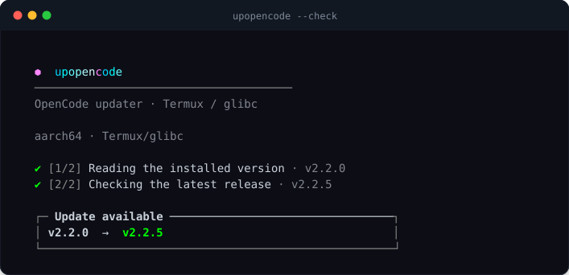
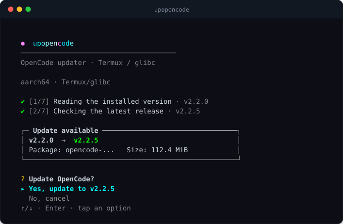
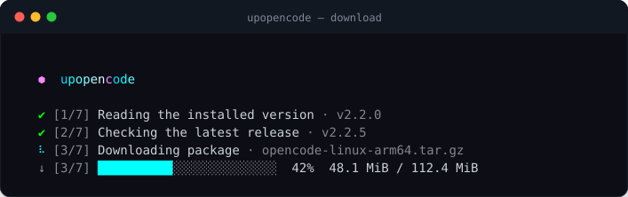

<div align="center">

# ⬢ upopencode

**OpenCode v2 installer & updater for Termux (glibc) and Linux.**
Fresh install · v1 → v2 migration · atomic updates · one-line progress.

[](https://github.com/oyenter37-sudo/upopencode/actions/workflows/ci.yml)
[](https://github.com/oyenter37-sudo/upopencode/releases)
[](LICENSE)
[](#requirements)
[](https://github.com/anomalyco/opencode/releases/tag/v2.2.5)
[](https://github.com/anomalyco/opencode/releases)

<!-- upstream:start -->
**Latest OpenCode: v2.2.5** · checked daily · [install or update with one command →](#quick-start)
<!-- upstream:end -->

</div>

## Quick start

Paste this into Termux (or any Linux terminal) and press Enter:

```sh
curl -fsSL https://raw.githubusercontent.com/oyenter37-sudo/upopencode/main/install.sh | bash
```

**That's it.** Pick the language in the menu (↑/↓ + Enter, or `1`/`2`/`3`),
then run `upoc` — it installs OpenCode or updates it to the latest v2.
No Node.js, no npm, no root.

> On Termux the installer offers to add `glibc` and `patchelf` if they are
> missing. Everything else is already there.

<div align="center">

</div>

---

## Why

The official OpenCode build is a **glibc** binary, and Termux ships **musl/Android**
libs. Copying it into `$PREFIX/bin` gives you `libc.so: invalid ELF header`,
a broken `LD_PRELOAD`, and no way to update it later.

`upopencode` handles all of it:

- detects **fresh install**, **broken install** and **legacy v1**;
- downloads the right asset for **arm64 / x64**;
- verifies **SHA-256**;
- patches the interpreter with `patchelf` (no `RUNPATH`, it would segfault);
- swaps the binary **atomically** and **rolls back** if it does not start;
- keeps your v1 around as `opencode-v1`;
- shows a pretty menu you can drive with keys **or a finger tap**.

## How it differs

Some Termux installers build OpenCode locally, compile `statx` shims and package a
`.deb` with `git`, `make` and `binutils`. This one takes the short safe path:
**no local build, no `.deb`, no toolchain.**

|  | upopencode | local-build installers |
|---|---|---|
| Toolchain | none — Bash + `curl` | `git`, `make`, `binutils`, `jq` |
| Source | official release tarball | cloned sources + local patches |
| Integrity | SHA-256 from `SHA256SUMS` | depends on the build |
| Update | atomic replace + automatic rollback | rebuild + `apt` |
| Disk | ≈112 MiB, archive deleted right after unpack | hundreds of MiB of build files |
| Languages | English + Русский | usually one |

Local builds are a valid fallback when the official binary refuses to start on a
particular device. `upopencode` targets the common case and keeps it small.

## Install

```sh
curl -fsSL https://raw.githubusercontent.com/oyenter37-sudo/upopencode/main/install.sh | bash
```

The installer asks which language you want — arrow keys, `1`/`2`/`3`, or a tap:

| Choice | Installed commands |
|---|---|
| **Both** | `upopencode` / `upoc` — Русский · `upopencode-en` / `upoc-en` — English |
| **English only** | `upopencode` / `upoc` — English |
| **Русский only** | `upopencode` / `upoc` — Русский |

Skip the menu with a flag:

```sh
# English only
curl -fsSL https://raw.githubusercontent.com/oyenter37-sudo/upopencode/main/install.sh | bash -s -- --en

# Russian only
curl -fsSL https://raw.githubusercontent.com/oyenter37-sudo/upopencode/main/install.sh | bash -s -- --ru

# both (no menu)
curl -fsSL https://raw.githubusercontent.com/oyenter37-sudo/upopencode/main/install.sh | bash -s -- --both
```

Then just run it:

```sh
upoc                # menu: install / update / migrate
upoc --check        # is there a newer version?
```

`upoc` always launches the build you picked. If you installed **both**, `upoc`
is the Russian one and `upoc-en` is the English one.

> **No Node.js, no Python, no npm.** Pure Bash + `curl`, `tar`, `sha256sum`, `df`
> and, on Termux, `patchelf` + `glibc` (the script offers to install them).

## Screenshots

<div align="center">


</div>

## Usage

> `upoc` runs in the language you chose. Installed both? `upoc-en` opens the English one.

| Command | What it does |
|---|---|
| `upoc` | interactive menu: install / update / migrate |
| `upoc --check`, `-c` | check installed vs latest version, change nothing |
| `upoc --dry-run`, `-n` | show the plan and disk space, download nothing |
| `upoc --yes`, `-y` | no prompts (no backup) |
| `upoc --force`, `-f` | reinstall even if the version matches |
| `upoc --restart`, `-r` | restart the background service after updating |
| `upoc --backup` | always keep a backup of the previous binary |
| `upoc --no-backup` | never keep a backup |
| `upoc --clean` | delete old backups and abandoned temp dirs |
| `upoc --alias set NAME` | add a short command that launches OpenCode |
| `upoc --alias show` | list launchers (`opencode`, `opencode2`, your aliases) |
| `upoc --alias remove NAME` | remove one of your aliases |
| `upoc --self-update` | update **upopencode itself** from GitHub |
| `upoc --uninstall` | remove upopencode itself, keep OpenCode |
| `upoc --uninstall-opencode` | remove OpenCode v2 and its launcher, keep upopencode |
| `upoc --no-color` | plain output for logs |

### Short commands

```sh
upoc --alias set code           # now "code" launches OpenCode
upoc --alias show
#   ✔ oc        → v2.2.5
#   ✔ code      → v2.2.5
#   ✔ opencode  (built-in)
```

The installer already creates `upoc` — the build you picked. With both installed you also get `upoc-en` for English.

### Keep it fresh

```sh
upoc --self-update
```

It downloads the latest build for the language you have installed, rewrites the
shebang for your platform and replaces itself atomically.

## How it works

1. **Detect** — architecture (`arm64` / `x64`), Termux vs Linux, installed
   version, whether the binary actually runs, and whether `opencode` is a v1.
2. **Resolve the latest v2** — npm dist-tags → GitHub atom feed → GitHub API,
   with retries and a hard time budget.
3. **Preflight** — check free disk space (peak ≈ 4.5 × asset + 30 MiB), offer
   `--clean` if it is tight.
4. **Download** — verify `SHA256SUMS`, delete the archive immediately after
   extraction.
5. **Patch** — `patchelf --set-interpreter` to the Termux glibc loader.
6. **Swap** — hardlink rollback, `mv` over the real binary, run `--version`,
   roll back automatically on failure.
7. **Link** — recreate `opencode` / `opencode2` symlinks; a legacy v1 becomes
   `opencode-v1`; optionally restart the background service.

## Requirements

**Termux** (Android, aarch64 / x86_64): `curl`, `tar`, `coreutils`, plus `glibc`
and `patchelf` (offered automatically) — that is what makes the glibc build run.

**Linux** (x86_64 / aarch64): `curl`, `tar`, `sha256sum`, `bash`.

## Uninstall

Two separate commands, so you never delete more than you meant to.

Remove **upopencode only** — OpenCode keeps working:

```sh
upoc --uninstall
```

Remove **OpenCode v2** — upopencode stays installed, so you can bring it back:

```sh
upoc --uninstall-opencode
```

Both ask for confirmation first; add `--yes` for scripts. Neither touches your
data or config:

- `~/.local/share/opencode` — sessions, storage
- `~/.config/opencode` — `opencode.jsonc`, MCP servers, plugins

## FAQ

<details>
<summary><b>Do I need Node.js, npm or root?</b></summary>

No. The installer is pure Bash + `curl`. On Termux it uses the official glibc
build and only asks for `glibc` + `patchelf` if they are missing. No root, no
proot, no Node.js.
</details>

<details>
<summary><b>Which devices are supported?</b></summary>

Termux on Android (**aarch64** and **x86_64**) and Linux (**x86_64** and
**aarch64**). A recent Termux from F-Droid or GitHub is recommended.
</details>

<details>
<summary><b>Where does it install things?</b></summary>

- Termux: `$PREFIX/bin` (usually `/data/data/com.termux/files/usr/bin`)
- Linux: `~/.local/bin`
- OpenCode itself: `~/.local/share/opencode2`
- Your config stays in `~/.config/opencode`

The installer tells you if its directory is not in `PATH` and prints the line to add.
</details>

<details>
<summary><b>Will it overwrite my OpenCode v1?</b></summary>

No. A legacy v1 is renamed to `opencode-v1` and keeps working; v2 is installed
next to it as `opencode` / `opencode2`.
</details>

<details>
<summary><b>How do I update OpenCode?</b></summary>

Run `upoc` and choose update, or check first:

```sh
upoc --check
```

`upopencode` itself updates separately:

```sh
upoc --self-update
```
</details>

<details>
<summary><b>What if the new binary does not start?</b></summary>

The swap is atomic: the previous binary is kept as a hardlink and restored
automatically when `--version` fails. Use `--backup` to always keep a copy and
`--clean` to remove old ones.
</details>

<details>
<summary><b>How do I remove only the installer or only OpenCode?</b></summary>

```sh
upoc --uninstall            # upopencode only, OpenCode keeps working
upoc --uninstall-opencode   # OpenCode only, upopencode stays
```

Neither command touches sessions or config.
</details>

<details>
<summary><b>Will I lose my sessions, API keys or settings?</b></summary>

No. `~/.local/share/opencode` (sessions, storage) and `~/.config/opencode`
(`opencode.jsonc`, MCP servers, plugins) are never modified or deleted.
</details>

<details>
<summary><b>Does it work without an interactive terminal (CI, SSH, scripts)?</b></summary>

Yes. Without a TTY the installer skips the menu and installs both builds. Choose
explicitly with `--en`, `--ru` or `--both`, and add `--yes` for other prompts.
</details>

<details>
<summary><b>Why not a `.deb` or a package repository?</b></summary>

That needs a local build or a separately maintained repo. `upopencode` takes the
official release tarball, verifies it and patches only the interpreter — so it
follows upstream the same day and needs no toolchain.
</details>

<details>
<summary><b>Is it safe? Can I read the script first?</b></summary>

Yes — the whole tool is in this repository (`upopencode`, `install.sh`), the
license is MIT, and every download is checked against `SHA256SUMS`. You can
inspect it before running:

```sh
curl -fsSL https://raw.githubusercontent.com/oyenter37-sudo/upopencode/main/upopencode -o upoc
less upoc
```
</details>

<details>
<summary><b>Which languages are available?</b></summary>

English and Russian. Pick one or both during install. With both installed,
`upoc` is Russian and `upoc-en` is English. A single language always gets
`upopencode` + `upoc`.
</details>

<details>
<summary><b>Something else went wrong. Where do I ask?</b></summary>

Open an issue: https://github.com/oyenter37-sudo/upopencode/issues — include the
output of `upoc --version`, `uname -m` and your Android/Termux version.
</details>

## Troubleshooting

<details>
<summary><b>“Could not determine the latest version”</b></summary>

The script tries npm, then the GitHub atom feed, then the GitHub API. If all
three fail, check your network:

```sh
curl -I https://registry.npmjs.org/-/package/@opencode%2Fcli/dist-tags
curl -I https://github.com/anomalyco/opencode/releases.atom
```

If `curl` works, just run the command again — brief DNS failures happen.
</details>

<details>
<summary><b>“Not enough space”</b></summary>

An update peaks at roughly **4.5 × 112 MiB + 30 MiB ≈ 536 MiB** (new binary +
old binary + extraction). Free some space or run:

```sh
upoc --clean
```
</details>

<details>
<summary><b>Updated, but the running service is still old</b></summary>

```sh
opencode2 service restart
```
or use `upoc --restart` next time.
</details>

## Contributing

- `upopencode` (English) is the **source of truth**.
- `upopencode-ru` is **generated**: edit the English script, then run

  ```sh
  python3 tools/translate.py to-ru
  ```

  CI fails if the two files are out of sync.
- Screenshots are generated from real terminal output:

  ```sh
  python3 docs/make_shots.py
  ```

## License

[MIT](LICENSE) © 2026 oyenter37-sudo

<div align="center"><sub>OpenCode is a separate project by its authors. This tool only installs it.</sub></div>
