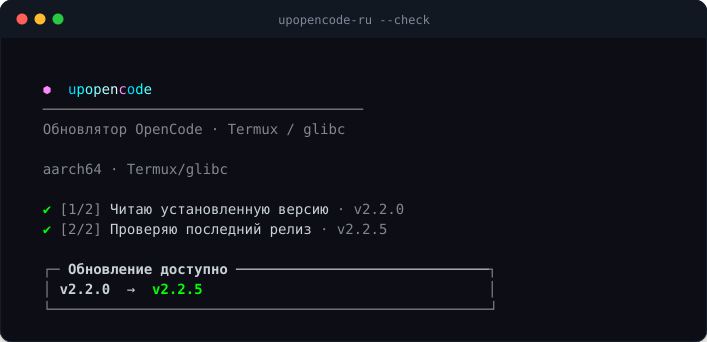
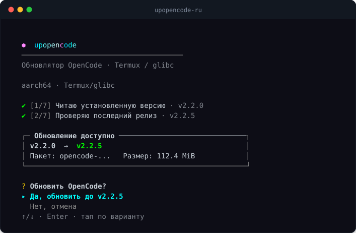
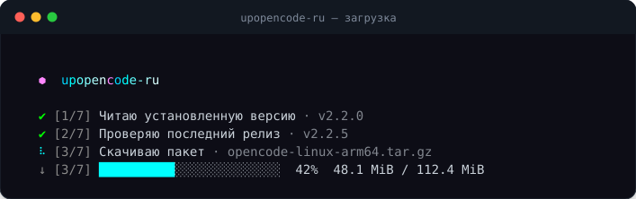

<div align="center">

# ⬢ upopencode

**Установщик и обновлятор OpenCode v2 для Termux (glibc) и Linux.**
Установка с нуля · переезд v1 → v2 · атомарные обновления · прогресс в одну строку.

[](https://github.com/oyenter37-sudo/upopencode/actions/workflows/ci.yml)
[](https://github.com/oyenter37-sudo/upopencode/releases)
[](LICENSE)
[](#требования)
[](https://github.com/anomalyco/opencode/releases/tag/v2.2.5)

<sub>Последняя проверка: <b>OpenCode 2.2.5</b> · ноябрь 2026</sub>

</div>

## Быстрый старт

Вставь эту команду в Termux (или любой Linux-терминал) и нажми Enter:

```sh
curl -fsSL https://raw.githubusercontent.com/oyenter37-sudo/upopencode/main/install.sh | bash
```

**Всё.** Выбери язык в меню (↑/↓ + Enter или `1`/`2`/`3`) — и `upoc` готов.
Никакого Node.js, npm и root.

> На Termux установщик сам предложит доставить `glibc` и `patchelf`, если их
> нет. Остальное уже на месте.

<div align="center">

</div>

---

## Зачем

Официальная сборка OpenCode — **glibc**-бинарь, а в Termux библиотеки **musl/Android**.
Если просто скопировать его в `$PREFIX/bin`, получишь `libc.so: invalid ELF header`,
сломанный `LD_PRELOAD` и никакой возможности обновляться.

`upopencode` берёт всё на себя:

- различает **чистую установку**, **повреждённую** и **старый v1**;
- качает нужный ассет под **arm64 / x64**;
- сверяет **SHA-256**;
- патчит интерпретатор через `patchelf` (без `RUNPATH` — с ним бинарь падает);
- меняет бинарь **атомарно** и **откатывается**, если новый не запустился;
- сохраняет v1 как `opencode-v1`;
- показывает красивое меню: стрелки, цифры, Enter и **тап пальцем**.

## Чем отличается

Некоторые установщики для Termux собирают OpenCode локально, компилируют
`statx`-shim и пакуют `.deb` через `git`, `make` и `binutils`. Здесь короткий
безопасный путь: **без локальной сборки, без `.deb`, без toolchain.**

|  | upopencode | установщики с локальной сборкой |
|---|---|---|
| Toolchain | не нужен — Bash + `curl` | `git`, `make`, `binutils`, `jq` |
| Источник | официальный release-tarball | клонированные исходники + патчи |
| Проверка | SHA-256 из `SHA256SUMS` | зависит от сборки |
| Обновление | атомарная замена + автооткат | пересборка + `apt` |
| Место | ≈112 МиБ, архив удаляется сразу после распаковки | сотни МиБ файлов сборки |
| Языки | English + Русский | обычно один |

Локальная сборка — разумный запасной вариант, если официальный бинарь не
запускается на конкретном устройстве. `upopencode` закрывает частый случай и
остаётся лёгким.

## Установка

```sh
curl -fsSL https://raw.githubusercontent.com/oyenter37-sudo/upopencode/main/install.sh | bash
```

Установщик спросит язык — стрелки, `1`/`2`/`3` или тап:

| Выбор | Установленные команды |
|---|---|
| **Обе** | `upopencode` / `upoc` — русский · `upopencode-en` / `upoc-en` — English |
| **Только English** | `upopencode` / `upoc` — English |
| **Только русский** | `upopencode` / `upoc` — русский |

Пропустить меню флагом:

```sh
# только английская
curl -fsSL https://raw.githubusercontent.com/oyenter37-sudo/upopencode/main/install.sh | bash -s -- --en

# только русская
curl -fsSL https://raw.githubusercontent.com/oyenter37-sudo/upopencode/main/install.sh | bash -s -- --ru

# обе (без меню)
curl -fsSL https://raw.githubusercontent.com/oyenter37-sudo/upopencode/main/install.sh | bash -s -- --both
```

Дальше просто:

```sh
upoc                 # меню: поставить / обновить / переехать
upoc --check         # есть ли новая версия?
```

`upoc` всегда запускает выбранную сборку. Если поставил **обе**, `upoc` — русская,
а `upoc-en` — английская.

> **Никакого Node.js, Python и npm.** Чистый Bash + `curl`, `tar`, `sha256sum`, `df`,
> а на Termux ещё `patchelf` и `glibc` (скрипт сам предложит их поставить).

## Скриншоты

<div align="center">


</div>

## Использование

> `upoc` запускается на выбранном языке. Поставил обе? `upoc-en` — английская версия.

| Команда | Что делает |
|---|---|
| `upoc` | интерактивное меню: поставить / обновить / переехать |
| `upoc --check`, `-c` | сравнить установленную и последнюю версию, ничего не менять |
| `upoc --dry-run`, `-n` | показать план и место, ничего не качать |
| `upoc --yes`, `-y` | без вопросов (бэкап не создаётся) |
| `upoc --force`, `-f` | переустановить, даже если версия та же |
| `upoc --restart`, `-r` | перезапустить фоновый сервис после обновления |
| `upoc --backup` | всегда оставлять бэкап старого бинаря |
| `upoc --no-backup` | никогда не оставлять бэкап |
| `upoc --clean` | удалить старые бэкапы и брошенные временные папки |
| `upoc --alias set ИМЯ` | короткая команда для запуска OpenCode |
| `upoc --alias show` | список лаунчеров (`opencode`, `opencode2`, твои алиасы) |
| `upoc --alias remove ИМЯ` | удалить свой алиас |
| `upoc --self-update` | обновить **сам upopencode** с GitHub |
| `upoc --uninstall` | удалить сам upopencode, OpenCode останется |
| `upoc --uninstall-opencode` | удалить OpenCode v2 и лаунчер, upopencode останется |
| `upoc --no-color` | без цветов (для логов) |

### Короткие команды

```sh
upoc --alias set code              # теперь "code" запускает OpenCode
upoc --alias show
#   ✔ oc        → v2.2.5
#   ✔ code      → v2.2.5
#   ✔ opencode  (служебное)
```

Установщик уже создаёт `upoc` — выбранную сборку. Если поставил обе, есть ещё `upoc-en` для английской.

### Обновлять сам апдейтер

```sh
upoc --self-update
```

Скачивает свежую сборку на установленном языке, правит shebang под платформу
и атомарно заменяет себя.

## Как это работает

1. **Определение** — архитектура (`arm64` / `x64`), Termux или Linux,
   установленная версия, запускается ли бинарь и не стоит ли v1.
2. **Поиск свежей v2** — npm dist-tags → atom-лента GitHub → GitHub API,
   с повторами и ограничением по времени.
3. **Проверка места** — пик ≈ 4.5 × размер ассета + 30 МиБ; если мало,
   предлагает `--clean`.
4. **Загрузка** — сверка `SHA256SUMS`, архив удаляется сразу после распаковки.
5. **Патч** — `patchelf --set-interpreter` на glibc-загрузчик Termux.
6. **Замена** — rollback через hardlink, `mv` поверх бинаря, запуск `--version`,
   автоматический откат при ошибке.
7. **Симлинки** — пересоздаёт `opencode` / `opencode2`; старый v1 становится
   `opencode-v1`; при желании перезапускает фоновый сервис.

## Требования

**Termux** (Android, aarch64 / x86_64): `curl`, `tar`, `coreutils`, плюс `glibc`
и `patchelf` (предложит поставить) — без них glibc-бинарь не запустится.

**Linux** (x86_64 / aarch64): `curl`, `tar`, `sha256sum`, `bash`.

## Удаление

Две отдельные команды — чтобы случайно не удалить лишнее.

Удалить **только upopencode** — OpenCode продолжит работать:

```sh
upoc --uninstall
```

Удалить **OpenCode v2** — upopencode останется, чтобы можно было поставить обратно:

```sh
upoc --uninstall-opencode
```

Обе команды сначала спрашивают подтверждение; для скриптов добавь `--yes`.
Данные и настройки не трогаются:

- `~/.local/share/opencode` — сессии и storage
- `~/.config/opencode` — `opencode.jsonc`, MCP-серверы, плагины

## FAQ

<details>
<summary><b>Нужны ли Node.js, npm или root?</b></summary>

Нет. Установщик — чистый Bash + `curl`. На Termux он использует официальную
glibc-сборку и просит доставить только `glibc` и `patchelf`, если их нет.
Без root, без proot, без Node.js.
</details>

<details>
<summary><b>На каких устройствах работает?</b></summary>

Termux на Android (**aarch64** и **x86_64**) и Linux (**x86_64** и
**aarch64**). Рекомендуется свежий Termux из F-Droid или с GitHub.
</details>

<details>
<summary><b>Куда всё ставится?</b></summary>

- Termux: `$PREFIX/bin` (обычно `/data/data/com.termux/files/usr/bin`)
- Linux: `~/.local/bin`
- Сам OpenCode: `~/.local/share/opencode2`
- Настройки остаются в `~/.config/opencode`

Если папки нет в `PATH`, установщик скажет об этом и покажет готовую строку.
</details>

<details>
<summary><b>Он затрёт мой OpenCode v1?</b></summary>

Нет. Старый v1 переименовывается в `opencode-v1` и продолжает работать, а v2
ставится рядом как `opencode` / `opencode2`.
</details>

<details>
<summary><b>Как обновить OpenCode?</b></summary>

Запусти `upoc` и выбери обновление, или сначала проверь:

```sh
upoc --check
```

Сам `upopencode` обновляется отдельно:

```sh
upoc --self-update
```
</details>

<details>
<summary><b>А если новый бинарь не запустится?</b></summary>

Замена атомарная: старый бинарь остаётся жёсткой ссылкой и возвращается
автоматически, если `--version` не сработал. `--backup` всегда оставляет копию,
`--clean` убирает старые.
</details>

<details>
<summary><b>Как удалить только установщик или только OpenCode?</b></summary>

```sh
upoc --uninstall            # только upopencode, OpenCode продолжает работать
upoc --uninstall-opencode   # только OpenCode, upopencode остаётся
```

Ни одна из команд не трогает сессии и настройки.
</details>

<details>
<summary><b>Я потеряю сессии, ключи API или настройки?</b></summary>

Нет. `~/.local/share/opencode` (сессии, storage) и `~/.config/opencode`
(`opencode.jsonc`, MCP-серверы, плагины) не изменяются и не удаляются.
</details>

<details>
<summary><b>Работает без интерактивного терминала (CI, SSH, скрипты)?</b></summary>

Да. Без TTY установщик пропускает меню и ставит обе сборки. Явно выбрать
язык можно флагами `--en`, `--ru` или `--both`, а для остальных вопросов
добавить `--yes`.
</details>

<details>
<summary><b>Почему не `.deb` и не свой репозиторий пакетов?</b></summary>

Для этого нужна локальная сборка или отдельно поддерживаемый репозиторий.
`upopencode` берёт официальный release-tarball, сверяет его и патчит только
интерпретатор — поэтому следует за upstream в тот же день и не требует
toolchain.
</details>

<details>
<summary><b>Это безопасно? Можно сначала посмотреть скрипт?</b></summary>

Да — весь инструмент лежит в этом репозитории (`upopencode`, `install.sh`),
лицензия MIT, каждая загрузка сверяется по `SHA256SUMS`. Можно посмотреть
до запуска:

```sh
curl -fsSL https://raw.githubusercontent.com/oyenter37-sudo/upopencode/main/upopencode -o upoc
less upoc
```
</details>

<details>
<summary><b>Какие языки есть?</b></summary>

Английский и русский. При установке можно выбрать один или оба. Если стоят
оба, `upoc` — русский, `upoc-en` — английский. При одном языке всегда
`upopencode` + `upoc`.
</details>

<details>
<summary><b>Что-то другое сломалось. Куда писать?</b></summary>

Открой issue: https://github.com/oyenter37-sudo/upopencode/issues — приложи
вывод `upoc --version`, `uname -m` и версию Android/Termux.
</details>

## Если что-то пошло не так

<details>
<summary><b>«Не удалось узнать последнюю версию»</b></summary>

Скрипт пробует npm, потом atom-ленту GitHub, потом GitHub API. Если все три
не ответили — проверь сеть:

```sh
curl -I https://registry.npmjs.org/-/package/@opencode%2Fcli/dist-tags
curl -I https://github.com/anomalyco/opencode/releases.atom
```

Если `curl` отвечает — просто запусти ещё раз: бывают кратковременные сбои DNS.
</details>

<details>
<summary><b>«Не хватает места»</b></summary>

Пик обновления — примерно **4.5 × 112 МиБ + 30 МиБ ≈ 536 МиБ** (новый бинарь +
старый бинарь + распаковка). Освободи место или запусти:

```sh
upoc --clean
```
</details>

<details>
<summary><b>Обновилось, но сервис всё ещё старый</b></summary>

```sh
opencode2 service restart
```
или в следующий раз используй `upoc --restart`.
</details>

## Участие

- `upopencode` (английский) — **источник правды**.
- `upopencode-ru` — **генерируется**: правь английский скрипт, затем

  ```sh
  python3 tools/translate.py to-ru
  ```

  CI упадёт, если файлы разойдутся.
- Скриншоты собраны из настоящего вывода терминала:

  ```sh
  python3 docs/make_shots.py
  ```

## Лицензия

[MIT](LICENSE) © 2026 oyenter37-sudo

<div align="center"><sub>OpenCode — отдельный проект его авторов. Этот инструмент только устанавливает его.</sub></div>
